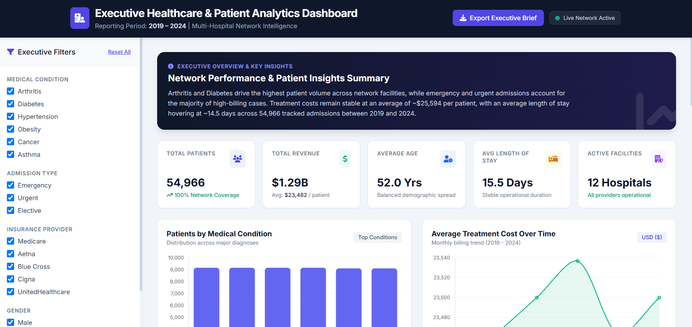

# 🏥 Healthcare Patient Analytics Dashboard

An executive dashboard built in Python (Jupyter Notebook) that analyzes patient, admission, insurance, and billing data across a multi-hospital network from 2019 to 2024.

Dashboard Preview 





## 📌 Project Overview
This project explores healthcare records to uncover patterns in patient volume, admission types, demographics, and treatment costs. It includes interactive filters and KPI cards designed for executive-level reporting.

## 📊 Key Metrics
| Metric | Value |
|---|---|
| Total Patients | 54,966 |
| Total Revenue | $1.29B |
| Avg. Cost per Patient | $23,482 |
| Average Age | 52.0 years |
| Avg. Length of Stay | 15.5 days |
| Active Facilities | 12 hospitals |

## 🔍 Dashboard Features
- Filters: medical condition, admission type, insurance provider, gender
- Patients by medical condition
- Average treatment cost trend (2019–2024)
- Age distribution by cohort
- Admission type breakdown (Emergency / Urgent / Elective)

## 🛠️ Tech Stack
- **Data Analysis:** Python, Pandas, NumPy
- **Visualization:** Matplotlib
- **Environment:** Jupyter Notebook, pycharm
- **Dashboard & AI:** built with Claude AI


## 📁 Project Structure
```
notebooks/   → analysis notebook
dashboard/   → dashboard file
data/        → dataset
prompts/     → prompt used to build the project
images/      → screenshots
```

## ▶️ How to Run
```bash
git clone https://github.com/<your-username>/healthcare-patient-analytics-dashboard.git
cd healthcare-patient-analytics-dashboard
pip install -r requirements.txt
jupyter notebook notebooks/healthcare_analytics_dashboard.ipynb
```

## ⚠️ Known Limitations
- The dataset appears to be synthetic, so findings should not be treated as real clinical insights.

## 👤 Author
Abhisht Pandey
